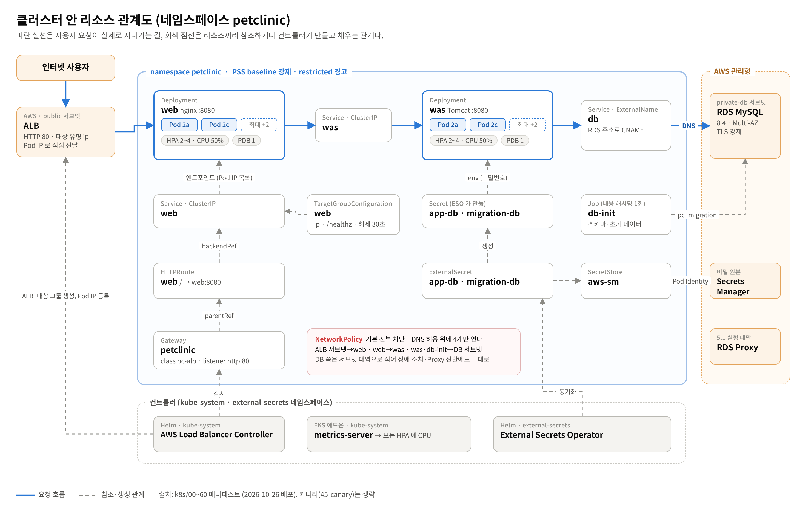

# PetClinic 3-Tier on Amazon EKS

spring-framework-petclinic(단일 WAR)을 web(nginx)·was(Tomcat) 컨테이너로 나눠 Amazon EKS 에 올리고, DB 는 RDS MySQL Multi-AZ 에 둔 1인 프로젝트다. 실제 운영 서비스로 가정하고 설계했고, 무중단 배포·자동 확장·DB 장애 조치를 측정으로 확인했다.

**보고서**: [AWS EKS 기반 PetClinic 3티어 서비스 구축·운영 보고서](<NOTION_REPORT_URL>) — 설계 결정과 대안, 검증 V1~V9, 심화 실험, 운영·비용



## 핵심 결과

- **부하**: 474,912건 실패 0, p95 92ms (초당 약 1,580 요청), HPA 2→4→2
- **무중단**: 롤링 배포 3회와 노드 drain 중 요청 983건에서 200 아닌 응답 0
- **DB 장애 조치**: 앱 영향 약 10초, Pod 재시작 0. 철거 후 스크립트만으로 약 1시간에 전체 재구축

## 구성

```
인터넷 → ALB (Gateway API, ip 대상) → web Pod (nginx) → was Pod (Tomcat 11)
       → db Service (ExternalName) → RDS MySQL 8.4 Multi-AZ (private-db 서브넷)
```

| 영역 | 내용 |
|---|---|
| 네트워크 | VPC 1개, AZ 2개 × 서브넷 4종(public·app·db·mgmt), AZ 마다 NAT, S3 게이트웨이 엔드포인트 |
| 클러스터 | EKS 1.36, 프라이빗 API 엔드포인트만, 관리형 노드 그룹 m7i-flex.xlarge × 2, 접속은 SSM 포트 포워딩 |
| 진입 | AWS Load Balancer Controller + Gateway API(HTTPRoute 가중치·헤더 라우팅) |
| 데이터 | RDS MySQL 8.4 db.m8g.large Multi-AZ, TLS 강제, 앱 계정은 DML 만 |
| 비밀 | Secrets Manager → External Secrets Operator, Pod IAM 은 Pod Identity |
| 이미지 | ECR 불변 태그, push 전 Trivy 관문(CRITICAL 이면 중단) |
| 앱 운영 | HPA·PDB·topologySpread, readiness gate, NetworkPolicy 기본 차단, PSS baseline |

## 디렉터리

```
env.sh, scripts/lib.sh   공통 변수·함수 (실값은 .state.env 에만, 커밋하지 않음)
scripts/NN-*.sh          구축·배포·검증 스크립트 (아래 순서)
scripts/remote/          관리 EC2 에서 SSM Run Command 로 실행되는 스크립트
infra/                   eksctl 클러스터 설정 템플릿, ECR 수명 주기 정책
docker/web, docker/was   이미지 (Dockerfile, nginx 설정, 엔트리포인트)
k8s/                     매니페스트 (namespace, secrets, services, was, web, gateway, canary, netpol, db-init Job)
diagrams/report/         보고서 그림과 그 원본(src/)
docs/design.md           설계 문서(기획서): 결정과 이유, 실제 결과. 스크립트 주석의 "기획서 N.N" 은 이 문서의 절이다
```

## 실행 순서

모든 스크립트는 로컬 Git Bash 에서 실행한다. 이름 태그로 자원을 먼저 찾고 없을 때만 만들므로, 중간에 끊겨도 다시 실행하면 이어서 진행한다.

```bash
./scripts/01-preflight.sh      # 자격 증명·할당량·AZ·인스턴스 유형 조회만
./scripts/10-network.sh        # VPC·서브넷·NAT·SG
./scripts/20-mgmt-ec2.sh       # 관리 EC2 (SSM 전용, 인바운드 0)
./scripts/31-rds.sh            # RDS Multi-AZ
./scripts/30-cluster.sh        # EKS → 프라이빗 전환
./scripts/21-tunnel.sh         # SSM 포트 포워딩 (kubectl 접속)
./scripts/40-addons.sh         # LBC, Gateway API CRD
./scripts/35-secrets-eso.sh    # 비밀, ESO
./scripts/32-db-bootstrap.sh   # DB 계정 (pc_app, pc_migration)
./scripts/34-ecr.sh            # ECR 저장소
./scripts/60-build-push.sh     # WAR 빌드 → 이미지 → Trivy → push
./scripts/70-deploy.sh         # Secret 동기화 → NetworkPolicy → 초기화 Job → Gateway → 앱
./scripts/90-verify.sh         # 검증 V1~V9

./scripts/75-canary.sh         # 수직 묶음 카나리 (up / weight / down)
./scripts/76-rds-proxy.sh      # DB 경로 전환 (use / direct)
./scripts/77-pitr.sh           # PITR 복구 리허설
./scripts/stop.sh / start.sh   # 야간 중지 / 기동
./scripts/destroy.sh           # 전체 철거 (pc-eks 입력 확인)
```

## 범위 밖

HTTPS(도메인 없음), 별도 모니터링 스택. 개선 과제는 보고서 7장에 정리했다.
